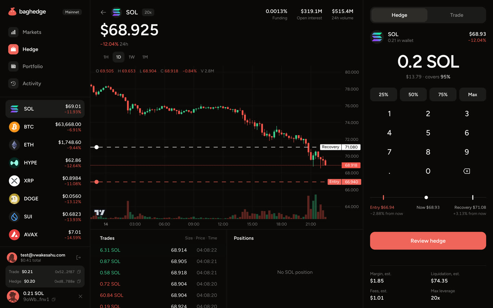
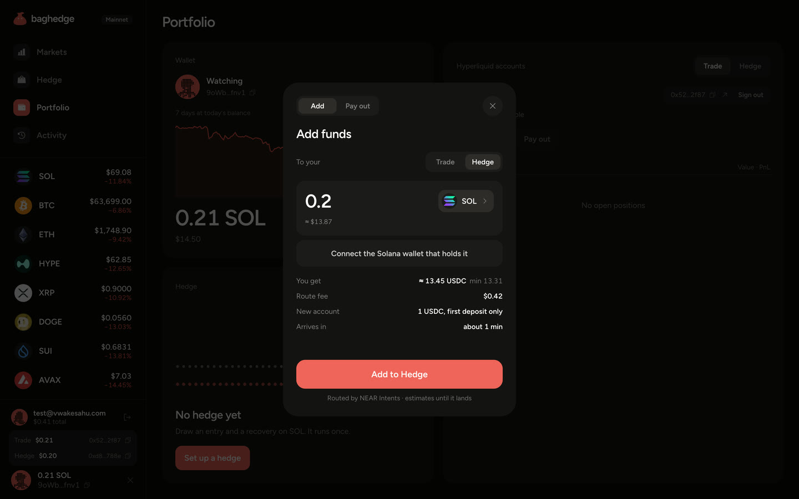
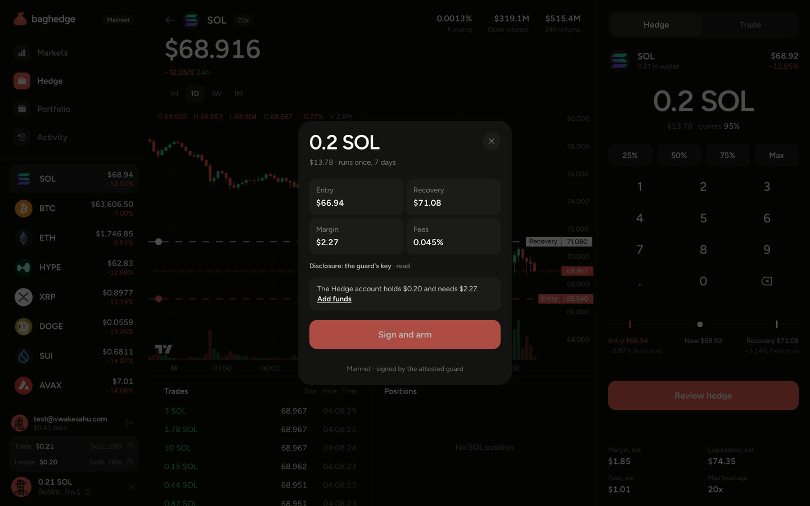
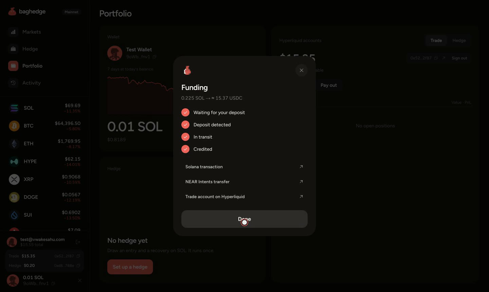
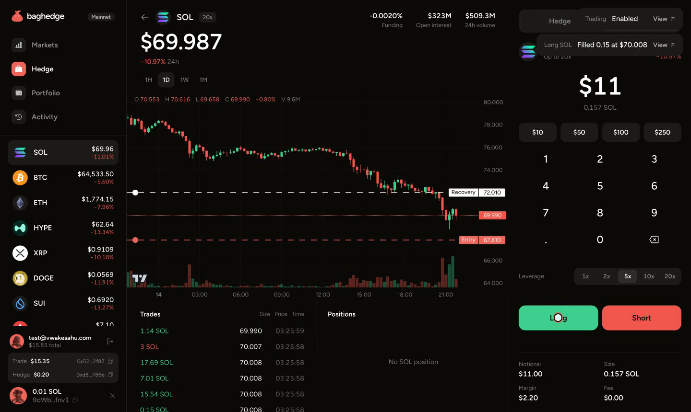
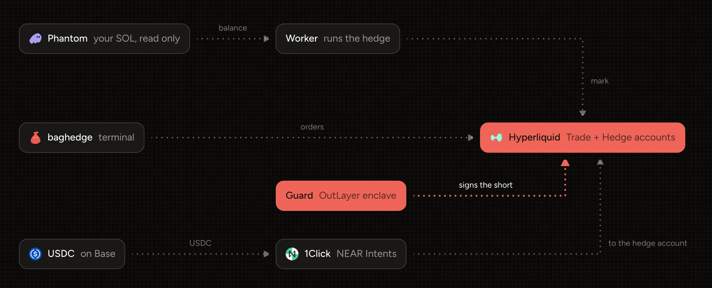
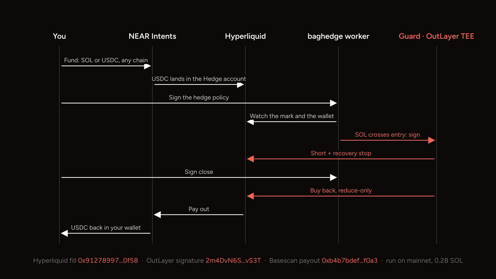

<p align="center">
  
</p>

<h1 align="center">baghedge</h1>

<p align="center"><b>Trade perps. Hedge your bag.</b><br/>
A Hyperliquid terminal that hedges the SOL you already hold, without moving it.</p>

<p align="center">
  <a href="https://app.baghedge.xyz"><b>Open the app</b></a> ·
  <a href="https://x.com/baghedge/status/2121753205399056754"><b>Watch the demo on X</b></a> ·
  <a href="JUDGES.md"><b>For judges</b></a> ·
  <a href="docs/media/baghedge-deck.pdf"><b>Pitch deck (PDF)</b></a> ·
  <a href="https://baghedge.xyz">Site</a>
</p>

<p align="center">
  &nbsp;&nbsp;
  &nbsp;&nbsp;
  &nbsp;&nbsp;
  
  <br/><sub>NEAR Intents · OutLayer TEE · Hyperliquid · Solana · Privy</sub>
</p>

<p align="center">
  
</p>

Built at the NEAR Hackathon, track **Unstoppable DeFi**. Live on mainnet.

Backend health: [mainnet](https://baghedge-api-mainnet.onrender.com/api/health) (attested guard)

## The idea

You hold SOL. It starts to fall. Today you have two options: sell it, or sit through the drop.

baghedge gives you a third. Draw an entry and a recovery on the chart. If SOL falls through your entry, a short opens on Hyperliquid in a separate **Hedge** account, sized to the SOL that's actually in your wallet. When SOL recovers, or when you say so, the short closes. Move SOL out of the wallet and the short shrinks with it. It never adds.

Your coins never move. Nothing to deposit, nothing to bridge out of cold storage. The wallet is only read.

**A worked example.** You hold 1,000 SOL at $140. baghedge shorts 600 SOL at $140, and SOL drops to $119. Without the hedge you're down $21,000. With it you're down $8,400, because the short made $12,600. All 1,000 SOL are still in your wallet. (Before costs; assumes a full fill and that the short tracks spot. The margin for that short is about $21,900 in USDC, and it comes back.)

## What you can do in the app

| | |
|---|---|
| **Sign in** | Email or Google through Privy. You get two accounts, **Trade** and **Hedge**, both yours. |
| **Fund** | From any of about 228 tokens on 38 chains, through NEAR Intents. The quote shows what arrives and every fee before you sign. |
| **Hedge** | Drag the entry and recovery on the SOL chart, review, sign once. An attested guard runs it from there. |
| **Trade** | Any of the 179 Hyperliquid perps, at the leverage you pick. |
| **Pay out** | Back to any token and any wallet. Every step links to its explorer. |

<details>
<summary><b>Screens from the app</b></summary>
<br/>

<table>
  <tr>
    <td></td>
    <td></td>
  </tr>
  <tr>
    <td align="center"><sub>Add funds: what arrives and every fee, first</sub></td>
    <td align="center"><sub>Review: entry, recovery, margin, fees, then sign once</sub></td>
  </tr>
  <tr>
    <td></td>
    <td></td>
  </tr>
  <tr>
    <td align="center"><sub>Credited, with Solana, NEAR Intents and Hyperliquid links</sub></td>
    <td align="center"><sub>A real trade, filled at $70.008</sub></td>
  </tr>
</table>

</details>

## How it fits together

<p align="center"></p>

And the life of one hedge:

<p align="center"></p>

The details:

- **Two accounts.** Trade and Hedge are different Hyperliquid master accounts. Aliases are rejected in the UI, the API and the guard.
- **Policy.** The Hedge owner signs one EIP-712 `HedgePolicy`: accounts, watched wallet, market, cap, entry, floor, recovery, buyback ceiling, expiry, required margin, and the guard agent and build hash. The TypeScript and Rust digests are cross-checked.
- **Worker** ([`server/worker.ts`](server/worker.ts)). For each Hedge account, one serialized tick does four things in order:
  1. reconcile every journaled order by client ID;
  2. confirm the recovery stop at the venue, and install a position stop if it's missing;
  3. decide entry, resize or close;
  4. reserve, sign, send, then reconcile again.

  If a send's result is unknown, the worker never retries it blind. Every buy is reduce-only.
- **Guard** ([`guard/`](guard/)). Rust `wasm32-wasip2` on OutLayer. It rebuilds each order from typed fields, checks it against the owner's policy (accounts, market, prices, size, reduce-only, expiry and cloid binding), and signs with a key that never leaves the TEE. It never signs raw bytes, transfers or withdrawals. The worker checks the recovered signer before anything reaches Hyperliquid.
- **Funding and payout** ([`server/intents.ts`](server/intents.ts)). 1Click `EXACT_INPUT` quotes. Refunds always go back to the owner. Credit is confirmed against the Hyperliquid balance, not only the provider's status.

## Proof it runs

**The full flow ran on mainnet with real funds:** fund through NEAR Intents, then an attested guard signs the hedge entry with its recovery stop, then SOL leaves the wallet and the hedge buys back reduce-only, then the owner closes the hedge while the manual Trade position stays put, then USDC is paid back to Base.

Every row links to on-chain or venue evidence. Raw records: [`docs/evidence/mainnet.jsonl`](docs/evidence/mainnet.jsonl).

| Step | Network | Evidence | Status |
| --- | --- | --- | --- |
| Fund the Hedge account from Base through NEAR Intents | **Mainnet** | Base tx [`0x2ba434e0…16ba`](https://basescan.org/tx/0x2ba434e01c6a154a23f3ab65e662d88152f4dba9ea9510918c2b62be017416ba) 15.0 USDC → Intents `SUCCESS` → Hyperliquid credit `0x6e6d6cf4…e6ed`: **14.683072 USDC usable margin** (~90 s) | ✅ |
| Guard build attested on OutLayer | **NEAR mainnet** | `public_key` run [`2oDKos4B…7buA`](https://api.outlayer.ai/attestations/by-tx/2oDKos4BKHkQXERKVKUUqiRD1DmsQnctVvHoaUBk7buA) by `anotherbaghedge.near`, WASM `ffe0e1dd…ced1c` → agent `0x38f05746…a70e`. REPORTDATA, measurements and Intel DCAP (`UpToDate`) independently verified. | ✅ |
| Guard agent approved on the Hedge account | **Mainnet** | `extraAgents(0x59c3…85cc)` lists `baghedge` → `0x38f05746…a70e` | ✅ |
| Owner-signed hedge policy armed (guard signer) | **Mainnet** | rule `0xb6e01a94…6309`: cap 0.28 SOL, entry 72.19, recovery 74.36 | ✅ armed |
| Guard-signed hedge entry with attached recovery stop | **Mainnet** | mark crossed 72.19 → guard signed in OutLayer ([`2m4DvN6S…vS3T`](https://api.outlayer.ai/attestations/by-tx/2m4DvN6S8A9j2HFvtopTH4STf6BVNtYwif5ojMLTvS3T), same attested WASM) → IOC sell `605230434689` **filled 0.28 SOL @ 72.205** (fill `0x91278997…0f58`); reduce-only recovery stop `605230434690` (trigger > 74.36, limit 75.08, 0.28) **open at the venue**; Trade account untouched. ~11 s from guard request to fill. | ✅ |
| Watched SOL moves out → reduce-only buyback | **Mainnet** | Phantom 0.40 → 0.1499 SOL → guard signed ([`9GFonDvJ…5BBx`](https://api.outlayer.ai/attestations/by-tx/9GFonDvJYMEFw9cmy6ucJAGu1oLm1xmjKY3BoL5j5BBx)) → reduce-only IOC `605233441503` **filled 0.14 SOL @ 72.203** (fill `0x67a9b704…cc0b`); hedge −0.28 → **−0.14**. Trade account unaffected (it held no position yet). | ✅ |
| Manual Trade long (separate account, own agent) | **Mainnet** | IOC long `605239853591` **filled 0.14 SOL @ 72.225** on Trade `0x80FD…6444` | ✅ |
| Owner closes the hedge; Trade position unchanged | **Mainnet** | owner-signed close → guard signed ([`BbsrLb94…2VDJ`](https://api.outlayer.ai/attestations/by-tx/BbsrLb945mjbCmAXcgVYe9dbDyx545asp9TsY8s32VDJ)) → reduce-only `605241804534` **filled 0.14 @ 72.262** (fill `0xd4150293…8602`); Hedge flat, no orders (stop `reduceOnlyCanceled`); **Trade still +0.14 SOL** | ✅ |
| Pay Hedge USDC back to Base | **Mainnet** | owner-signed `sendAsset` 13.5 USDC (`0x83ea1acf…df8c`) → Intents `SUCCESS` → Base tx [`0xb4b7bdef…f0a3`](https://basescan.org/tx/0xb4b7bdefc4261d3ccc9a0ccc4f043f53f3fd86a5da720bfedd649971a3e1f0a3): **13.29703 USDC received** by the owner (receipt checked on Base) | ✅ |
| **Multi-owner guard: full cycle for a per-owner agent** (public service, release `6d85a8f`) | **Mainnet** | Hedge `0x59c3…85cc` approves its own derived agent `0x96fd5f5a…c65a` → guard ([`CcWtZNNA…rRiG`](https://api.outlayer.ai/attestations/by-tx/CcWtZNNAkvZzGojji6YHbtNq7WCviW6o4FmPeu8MrRiG), build `1a847d88…`, `sign_order`/entry) → IOC sell `605392198623` **filled 0.2 SOL @ 70.573**, recovery stop `605392198624` open → owner close, guard ([`Dt7F2RmA…JCS`](https://api.outlayer.ai/attestations/by-tx/Dt7F2RmAmFXzEcZFMpG48hPAua4aZ6hX5BujUuZJDJCS)) → reduce-only `605394485511` **filled 0.2 @ 70.238**, stop `reduceOnlyCanceled`, Trade untouched → `sendAsset` 8.69 USDC → Base tx [`0x94e83167…5bf3`](https://basescan.org/tx/0x94e83167a29a80a405909f554529370ee5d438b62bf39343f09cabee7b075bf3): **8.486894 USDC received** | ✅ |

The same flow ran again through the app on 2026-11-14 with a fresh Privy account; its transactions are in [`JUDGES.md`](JUDGES.md#the-full-flow-on-mainnet-through-the-ui).

## Trust boundary and disclosed risks
- **The owner keeps control:** funding, agent approval, the policy, disarm, close and payout are all owner wallet signatures. The guard agent can't withdraw or transfer, because Hyperliquid forbids it for agents.
- **What a compromised signer could do:** trade the Hedge account's posted margin badly. It can't move funds out. The dedicated Hedge account caps the loss at the margin posted.
- **One guard, an agent per user:** the multi-owner guard derives a separate Hyperliquid agent for every Hedge owner inside the enclave. Each owner approves only their own agent, and a policy naming another owner's agent is refused (verified live on mainnet).
- **Guard state:** the guard is stateless. Cumulative size caps and data freshness are enforced by the worker, not inside the enclave (documented in [`docs/BAGHEDGE_CONTEXT.md`](docs/BAGHEDGE_CONTEXT.md) §22).
- **Disclosed:** the guard's NEAR execution account (`anotherbaghedge.near`) had its key shared during development, and the team chose not to rotate it. Someone holding it could request extra guard signatures under **any user's** public signed policy, trading that user's Hedge margin within the policy's limits, and could spend the account's NEAR. They can **never withdraw** funds. `GET /api/health` → `disclosures` carries this so the app can show it before funding.
- **Platform trust:** Hyperliquid (venue and mark price), OutLayer/Intel TDX, NEAR Intents, and Solana RPC data. Auto-deleveraging and funding can change the outcome.

## Try it

**No wallet at all, a replay:**
```sh
bun install && bun run demo:replay
```
It prints the two-account flow (manual long, hedge entry, wallet transfer, buyback, closes) with exposure after each step. **The replay uses sample fills.**

**Run it yourself:**
```sh
bun install                       # root dependencies first
cp .env.example .env.mainnet      # fill in; see comments
bun run start:mainnet             # API + hedge worker on :3001
bun run check                     # typecheck + 68 unit tests
cargo +stable test --locked --manifest-path guard/Cargo.toml   # guard tests
cd terminal && bun install && bun run dev                      # the app, see terminal/README.md
```
Open `http://localhost:3001/ops` (with `OPS_PAGE=1`) for the owner console. It connects a browser or phone wallet (WalletConnect) to fund, approve the agent, sign a hedge policy, close and pay out.

## What's where

| Folder | What it is |
|---|---|
| [`terminal/`](terminal/) | The app at app.baghedge.xyz, and [`terminal/e2e/`](terminal/e2e/), the browser suite that ran the mainnet flow |
| [`server/`](server/) | The API and the hedge worker |
| [`guard/`](guard/) | The Rust guard that runs in OutLayer and signs hedge orders |
| [`shared/`](shared/) | The EIP-712 policy and amounts, shared by the server and the browser |
| [`landing/web/`](landing/web/) | baghedge.xyz |
| [`docs/`](docs/) | [`API.md`](docs/API.md), [`INTEGRATION.md`](docs/INTEGRATION.md), the design brief and the raw evidence |
| [`AGENTS.md`](AGENTS.md) | Engineering rules: no floats for money, journal before writing, reconcile before retrying, and more |

Every folder has its own README.

## Built at NEAR HACKATHON

- **All new code.** Every commit is from the development window (from 2026-11-14); there's no pre-hackathon baseline. The submitted state is tagged [`hackathon-submission`](../../tree/hackathon-submission).
- **The NEAR integration:** the hedge guard runs as an attested Rust WASM build on **OutLayer** (NEAR TEE), with a per-owner agent derived inside the enclave; money moves in and out through **NEAR Intents 1Click** from about 228 tokens.
- **AI assistance:** large parts of the code, docs and tests were written with Claude Code and Codex, then reviewed, tested and run on mainnet by the team.

## Libraries
Bun, TypeScript, [`@nktkas/hyperliquid`](https://github.com/nktkas/hyperliquid), viem, WalletConnect, `near-api-js`, `@solana/web3.js` (scripts); Rust `k256`, `sha3`, `serde`, `rmp-serde` (guard); Next.js, React, lightweight-charts and the Solana wallet adapter (terminal). Hyperliquid, NEAR Intents 1Click, OutLayer and FastFS.

## License
[Business Source License 1.1](LICENSE). The source is public. You may read, copy, modify and use it **non-commercially**, but production or commercial use needs a license from Baghedge. Each version converts to GPL-2.0-or-later on 2030-11-15, or four years after it's first published, whichever comes first.
